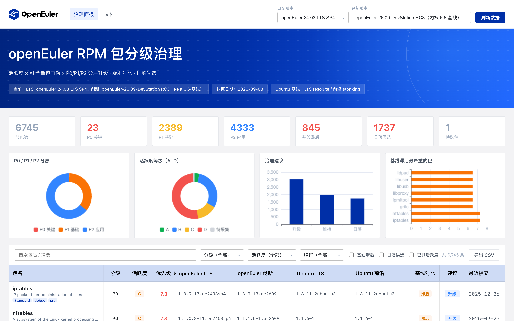

# openEuler RPM 包分级治理平台

> 活跃度统计 · AI 全量包画像 · P0/P1/P2 分层升级 · 版本对比 · 日落候选 · 人力估算

基于公开 API，把 openEuler **最新 LTS** 与 **最新创新版（26.09-DevStation）** 的全量软件包信息抓取下来，
与 Ubuntu（LTS + 前沿）逐包比对，标记核心包（P0/P1/P2）与长期未更新/无人维护的包，
并用一个可交互的前后端界面完成生态兼容性治理。



## 核心能力

- **多流版本切换**：顶部切换 LTS（24.03 LTS / SP1–SP4）或创新版（已发行 24.09 / 25.03 / 25.09，
  以及 26.09-DevStation 的全部 RC / 每日构建），版本列与"落后基线"实时重算。
- **全量包画像**：活跃度 A–D 分级、核心/重要/普通、P0/P1/P2 分层、处置建议（升级/维持/合并/日落）一站式计算。
- **跨发行版版本对比**：openEuler vs Ubuntu（LTS + 前沿）逐包比较上游版本，输出落后分级；可选 SUSE 适配器。
- **日落保护**：ISO 基线与反向依赖双重兜底，避免误杀有依赖的包。
- **SIG 归属**：从 community 仓解析包 → SIG 映射（覆盖率约 97%，113 个 SIG），逐包画像与 `/api/meta` 透传。
- **人力估算**：升级 + CVE + 例行维护折算人日/人年，汇总团队容量。
- **逐包详情**：分级/活跃度/重要性徽章、反向依赖、关键依赖、版本对比四基准线、月度活跃度趋势图。

## 快速开始

```bash
# 1) 安装依赖（Python 3.10+）
make install

# 2) 构建前端（pnpm）
make ui

# 3) 实时采集全量数据（公开 API，含活跃度约 3–4 分钟）
make build            # 全量
make build-quick      # 跳过活跃度深扫，更快

# 4) 启动服务（带实例发现/端口管理），打开 http://127.0.0.1:8000
make dev              # 停止 make stop / 状态 make status / 重启 make restart
```

离线/快速重建：`make seed` 优先复用本地缓存生成确定性快照（会覆盖 `packages.json`）；
仓库工作区已包含一份真实采集的 `data/cache/packages.json`，可直接 `make run` 查看效果。

`scripts/build.py` 支持按模块跳过采集：`--no-activity` / `--no-pypi` / `--no-npm` / `--no-oemaker` / `--no-sig`，以及 `--activity-limit N` 限制活跃度采样量。

## 数据来源（全部为公开 API，无需鉴权）

| 来源 | 用途 |
| --- | --- |
| `repo.openeuler.org` | openEuler 稳定镜像：解析 `repodata/primary.xml.zst` 得到全量包/版本/依赖 |
| `dailybuild.openeuler.openatom.cn` | 创新版 / RC / 每日构建（DevStation） |
| `api.gitcode.com/api/v5` | 逐包活跃度（commits / PR / Issue）与全量仓库最近提交 |
| `archive.ubuntu.com/ubuntu` | Ubuntu LTS + 前沿基线，自动识别最新版本 |
| `pypi.org` / `registry.npmjs.org` | `python-*` / `nodejs-*` 模块的上游画像 |
| `src-openeuler/oemaker` | 官方 ISO 清单（comps 组 / exclude / DevStation rpmlist） |
| `openeuler/community` | 包 → SIG 归属（`sig/<SIG>/sig-info.yaml`） |
| `rules/governance_rules.yaml` | 治理规则：P0/P1/P2、依赖闭包、活跃度参数、人力模型、lag_bonus |

采集**可缓存、可恢复、限流友好**：repodata / Ubuntu / 活跃度 / oemaker / SIG 分文件缓存，重复执行只补增量；
生产环境可用 `ACTIVITY_TOKEN` 提高 GitCode 限流水位。

## 架构

```text
pkg-governance/
├── backend/
│   ├── app/
│   │   ├── server.py            # FastAPI REST + 静态 SPA
│   │   ├── config.py            # 数据源与运行参数
│   │   ├── models.py            # Package / RepoSignals / Comparison / Governance
│   │   ├── utils.py             # 版本比较（rpm/dpkg 语义）、日期、HTTP
│   │   ├── collectors/
│   │   │   ├── openeuler.py     # 流发现（LTS/创新/RC/每日）+ repodata 采集
│   │   │   ├── repodata_parser.py  # primary.xml(.zst/.gz) → 源包记录 + 依赖图
│   │   │   ├── repos.py         # GitCode 全量仓库最近提交
│   │   │   ├── gitcode.py       # 活跃度/待办采集（并发 + 缓存 + 断点续传）
│   │   │   ├── ubuntu.py        # Ubuntu 基线（自动识别 LTS/前沿）
│   │   │   ├── pypi.py          # PyPI 上游画像
│   │   │   ├── npm.py           # npm registry 上游画像
│   │   │   ├── oemaker.py       # oemaker comps → ISO 基线/排除清单
│   │   │   ├── sig.py           # community 仓 → 包→SIG 归属
│   │   │   └── suse.py          # 可选 openSUSE 适配器（预留）
│   │   └── engine/
│   │       ├── grading.py       # A–D 活跃度分级（对数刻度 + 事件下限）
│   │       ├── importance.py    # 核心/重要/普通 + P0/P1/P2 + Python 闭包
│   │       ├── compare.py       # 跨发行版上游版本比较 → lag_degree
│   │       ├── disposal.py      # 升级/维持/合并/日落 + 无人维护检测
│   │       ├── python_gov.py    # pip 模块治理
│   │       ├── nodejs_gov.py    # npm 模块治理
│   │       ├── effort.py        # 人日/人年估算
│   │       ├── rules_loader.py  # 治理规则加载
│   │       └── pipeline.py      # 组装全量包画像 + 治理优先级评分
│   └── data/
│       ├── rules/governance_rules.yaml
│       └── cache/               # 生成式缓存（gitignore）
├── frontend/                    # Vite + React + TS + ECharts 单页面板（pnpm 管理，视觉复刻 openEuler 官网）
├── scripts/
│   ├── build.py                 # 全量实时采集 → packages.json
│   ├── seed.py                  # 离线确定性种子（优先复用本地缓存）
│   └── dev.py                   # 服务生命周期：实例发现/端口管理/健康检查
├── docs/scoring-v2.md           # 评分体系 v2 设计与社区对标依据
├── Makefile
└── .env.example
```

## REST API

| 方法 | 路径 | 说明 |
| --- | --- | --- |
| GET | `/api/health` | 健康检查 |
| GET | `/api/meta` | 数据源/流/基线/SIG 元信息 |
| GET | `/api/streams` | 流目录（全部 LTS + 已发行创新版 + DevStation RC/每日） |
| GET | `/api/summary` | 分布统计、工作量、Top 落后/日落 |
| GET | `/api/digest?lts=&innov=` | 轻量包列表 + 摘要（可按流切换） |
| GET | `/api/packages` | 分页 + 筛选（q/p_level/grade/importance/disposal/lagging/sunset/sort） |
| GET | `/api/packages/{name}?lts=&innov=` | 单包完整画像（随所选流） |
| GET | `/api/packages/{name}/activity` | 该包月度活跃度序列 |
| GET | `/api/reload` | 重新加载数据集缓存 |
| POST | `/api/refresh?scope=quick\|full` | **在线刷新**：重新从公开 API 采集并重建数据集（后台任务） |
| GET | `/api/refresh/status` | 刷新进度（step / progress / message / result） |

### 在线刷新（页面右上“刷新数据”）

“刷新数据”是真正的在线重采集，不是重新读缓存：后台线程调用 `app.build_job.run_build`，
重新发现版本目录、重新下载各源 `repomd`/`primary`（repomd 每次必取，primary 以校验和命名，
仓库更新即自动重下）、刷新 Ubuntu 基线与活跃度，最后重写 `packages.json` 并热加载。

- **快速刷新（quick，默认）**：重新发现版本目录（新 RC/每日构建）+ 重采默认 LTS/创新 pair 的全源数据 + Ubuntu + 活跃度增量。
- **全量刷新（full）**：在快速基础上，强制重采全部流的版本矩阵、活跃度、PyPI、npm、oemaker ISO 清单与 SIG 归属。

页面顶部会显示进度条（如 `采集流版本：openEuler-26.09-DevStation-rc6`），完成后自动重载面板。
CLI 等价命令：`python scripts/build.py --quick` 或 `python scripts/build.py`（全量）。

## 治理模型

四维流水线（对应设计文档《RPM 包分级治理：月度活跃度 × AI 全量包画像 × 分层升级》）：

1. **月度活跃度** — `engine/grading.py`：提交·PR·Issue 月度序列做 1/3/6/12 月滚动对数加权，
   叠加最近提交事件下限（≤180 天不低于 B、≤365 天不低于 C）→ A/B/C/D；无实测数据标 N/A，不武断判 D。
2. **AI 包画像** — `engine/importance.py`：活跃度 × 重要性（反向依赖百分位）× 关键包（Python 依赖闭包）
   三维分类 → 核心/重要/普通 + P0/P1/P2；确定性规则模拟，可无缝替换/叠加真实 LLM 评分。
3. **版本对比** — `engine/compare.py`：剥发行后缀与 epoch 的上游版本比较 → 落后分级
   `lag_degree`（patch/minor/major），update/EPOL 仓有 backport 时加分减半。
4. **人力估算** — `engine/effort.py`：人日/包 = 升级 + CVE + 例行维护 → 团队容量。

分层升级波次：P0 最小关键集（kernel/glibc/openssl/systemd + 包管理/引导栈 + Python 闭包）→
P1 基础包（手工清单 ∪ iso_baseline ∪ 反向依赖 p75 兜底）→ P2 上层应用。
评分公式与 Fedora/Debian/SUSE 对标依据见 [docs/scoring-v2.md](docs/scoring-v2.md)。

### 语言生态与日落治理

- **Python/pip**：系统源仅保留为其他系统包提供运行时依赖的模块。被核心/关键包依赖的保留并对齐上游；
  仅被非关键包依赖的标记迁移提示（venv / PyInstaller / shiv / pex / 容器镜像）；作为其他包
  `BuildRequires` 构建依赖的保留在系统源（构建根无法用 venv 替代）；以上都不是才建议日落。
  PyPI 停更与 `Requires-Python` 屏障仅作风险备注（`engine/python_gov.py`）。
- **Node.js/npm**：判定逻辑相同（`engine/nodejs_gov.py`）；nodejs/npm/pnpm/yarn 等工具链作为开发者
  生态入口保留维护，不参与日落。
- **日落严格化**：仅当 D 级 + 无反向依赖（运行时与构建依赖都为空）+ 非关键才建议日落；
  ISO 基线包命中 `sunset_protection` 时回退 maintain 并备注。
- **长期未更新**：超 180 天无提交且有未闭环 Issue/PR → 标记"长期未更新/疑似无人维护"。

### 数据口径

- **源聚合**：同一 `src-openeuler` 包分散于 OS/everything/EPOL/debuginfo/update 等仓；采集按源聚合，
  version 取二进制源中最新并打 `has_source`/`has_debug`/`in_epol`/`in_update`/`in_os` 标记。
- **版本比较**：剥 `.oe`/`.el`/`.fc`/`-0ubuntu` 发行后缀与 epoch 后只比上游版本；`source_aliases`
  处理改名包（kernel↔linux）；Ubuntu repack 后缀（`+dfsg`/`+ds`/`+really`）按语义剥离，避免误报落后。
- **反向依赖（两套图）**：运行时依赖取二进制仓 `primary.xml` 的 provides/requires；构建依赖取
  source / update-source 仓 `arch="src"` 包的 `rpm:requires`（SRPM 头的 spec 级 requires =
  各子包 Requires ∪ BuildRequires），再减去运行时 capability 得到纯构建边。P 分级的百分位用两者
  较大值，P0 `core` 判定仍只看运行时；日落保护取两者并集。capability 归一化保留命名空间
  （`python3dist(x)`/`npm(x)` 完整匹配），SONAME 剥版本保留架构后缀。
- **DevStation**：每个 RC 按 kernel 变体展开为独立流，基线排最前；默认创新版取最新 RC 的基线变体。
  稳定镜像发布后自动切换为 `repo.openeuler.org`，无需改配置。

## 工程能力

| 能力 | 工具 | 入口 |
| --- | --- | --- |
| Python lint/format | ruff（`E,F,W,I,UP,B`，行宽 100） | `make lint` / `make format` |
| Python 类型检查 | mypy（backend/app + scripts） | `make typecheck` |
| 前端 lint / 类型 | eslint 9 + typescript-eslint / tsc | `make lint` / `make typecheck` |
| 一键质量门 | 全部串起来 | `make check` |
| 服务生命周期 | 实例发现、幂等启动、端口冲突拒绝/自动改道、健康检查、优雅停止 | `make dev` / `make stop` / `make status` / `make restart` |

Agent 协作规范见 [AGENTS.md](AGENTS.md)；开发流程 skill 见 `.trae/skills/pkg-gov-dev/`。

## 局限与说明

- 活跃度采集为全量深扫（每包一次 commits 查询，活跃包另取 PR/Issue），依赖 GitCode 公共 API 限速，
  首轮为长任务；`activity.json` 缓存支持重跑增量续传；休眠仓（一年无提交）直接评 D。
- 源码包名与仓库名不一致时按规则映射（大小写、`java-X-openjdk`→`openjdk-X`、`rust-`/`python-` 前缀等），
  约 1% 无法映射的包活跃度显示 N/A。
- SUSE 基线为预留适配器（`collectors/suse.py`），按需开启。
- 前端改动需 `make ui` 重建 dist 才可见；server 代码改动需 `make restart`；数据采集逻辑改动需 `make build`。

## License

Mulan PSL v2（示例数据来源于各公开发布源，版权归各自方所有）。
